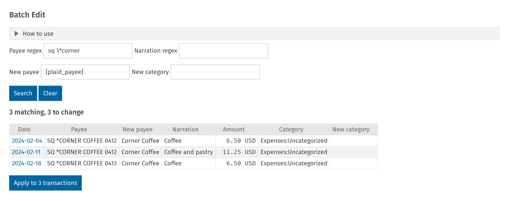

# Batch Edit

```beancount
2020-01-01 custom "fava-extension" "beancount_sg.ext.batch_edit"
```

Changes the payee and/or category of many transactions at once, e.g. to clean up the payees a bank
import gives you.



1. Search by **payee regex** and/or **narration regex**, within the current Fava filter. Regexes
   are case-insensitive and match from the start of the text: `coffee` matches "Coffee Shop",
   `.*coffee` matches "Corner Coffee".
2. Enter a **new payee** and/or **new category** (an income or expense account). The new payee can
   use `{key}` placeholders filled from each transaction's metadata, as `{plaid_payee}` does above;
   transactions without that key keep their payee.
3. Check the preview, which shows each matching transaction and what would change. Click a date to
   open the transaction.
4. **Apply** edits the ledger files, then lists the edited transactions as they now are.

A transaction's category is its income or expense posting. A split transaction, with two or more,
shows `-SPLIT-`: its payee can be changed, but not its category.

The search is kept in the page's URL, so it survives reloads and can be bookmarked.
