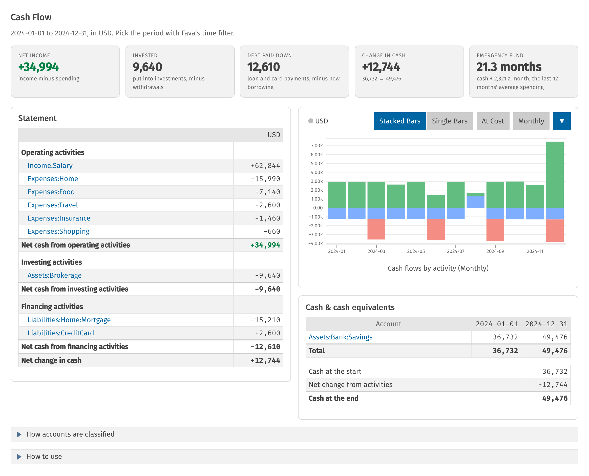

# Cash Flow

```beancount
2020-01-01 custom "fava-extension" "beancount_sg.ext.cash_flow"
```

A cash-flow statement: where your cash came from and where it went, in operating, investing and
financing activities, reconciled with the change in your cash.



## The cards

The cards name each section's total in plain terms, with how it's made up below:

| Card | Section | |
| --- | --- | --- |
| **Net income** | Operating | Income minus spending: positive is a surplus, negative a deficit. |
| **Invested**, or **Withdrawn from investments** | Investing | Money put into investments minus money taken out, named for whichever was larger. |
| **Debt paid down**, or **Borrowed** | Financing | Loan and card payments minus new borrowing, named for whichever was larger. |
| **Change in cash** | | Cash at the end minus cash at the start. |
| **Emergency fund** | | Cash at the end, in months of spending (see below). |

Only net income is colored, green for a surplus and red for a deficit, since that's clearly good
or bad. Investing and financing aren't: investing or paying down debt is usually good, though it
takes money out of cash.

## The statement

Accounts are classified by their **cash-flow role**, using the same metadata and defaults as
[Beancount.io's cash-flow report](https://beancount.io/blog/2026/08/28/declare-cash-flow-roles-in-your-ledger),
on the account's `open` directive:

```beancount
2020-01-01 open Assets:MoneyMarket
  cash-flow-role: "cash"
```

- **Cash** (`cash`): the cash and equivalents whose change the statement explains. Moving money
  between cash accounts doesn't show up.
- **Operating, investing and financing** (`operating`, `investing`, `financing`): every other
  account's flows over the period are a line in its role's section, as its effect on cash: money
  in is positive, money out negative, e.g. investing −9,640 is 9,640 invested. Income and
  expenses are rolled up to their top-level category, e.g. `Expenses:Food`.

Without a declared role (a parent's applies to its subaccounts), assets named with Cash, Checking,
Savings or Bank are `cash`, other assets `investing`, liabilities and equity `financing`, and
income and expenses `operating`. A declared value that isn't a role (e.g. a typo) is reported as
an error and ignored. The page's "How accounts are classified" section lists each account's role
and where it came from.

**Credit cards** are `financing`, like any liability. Spending on a card is in operating, by
expense category, and the card's line in financing is only its net change over the period:
charges minus payments. A card paid in full each month nets to about zero; one carrying a balance
shows as borrowing, or as repaying it.

## Reconciliation

The **Cash & cash equivalents** panel lists each cash account at the start and end of the period,
and reconciles them: cash at the start, plus the net change from the activities, is cash at the
end. Flows are valued at each transaction's date and cash at its market value at the start and
end, in the first `operating_currency`. If those differ, e.g. from exchange rates moving on cash
held in another currency, a **change in value** line shows the difference.

## Emergency fund

How many months of spending your cash covers: cash at the end of the period, divided by average
monthly spending (expenses) over the 12 months up to it. It uses 12 months whatever the period, so
a month's filter or a year-to-date year doesn't make it seasonal.

## Period and filters

The period is Fava's time filter, or the last 12 months (this month to date and the 11 before it)
without one. A time filter ends today at the latest, so this year is year-to-date. Fava's account
and advanced filters apply, as on Fava's own reports.

The chart shows each activity's flows per interval, from the chart's interval menu (e.g. monthly).
Click a bar's date for that interval, or part of a bar for the income statement (operating) or
balance sheet (investing and financing). Click a statement line or cash account for its account
page.
