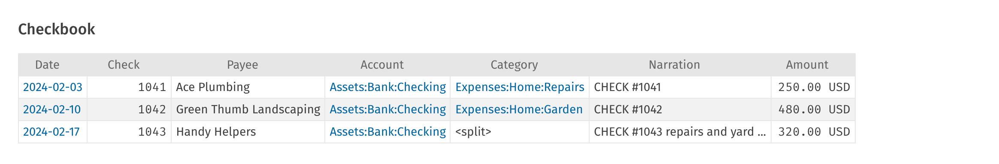

# Checkbook

```beancount
2020-01-01 custom "fava-extension" "beancount_sg.ext.checkbook"
```

Lists the checks in the current Fava filter: transactions with `check-no` metadata, which
[`add_check_numbers`](../../README.md#beancount_sgpluginsadd_check_numbers) can add from
narrations like `CHECK #1042`.



- **Account** is the Assets or Liabilities account the check was written from: the one such
  posting that's negative, blank if there isn't exactly one.
- **Category** is the other posting's account, or `<split>` if there are several.
- **Amount** is the positive amount paid.
- Click a date to open the transaction; click a column header to sort.
