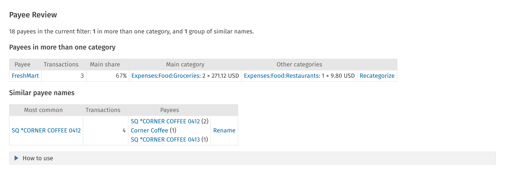

# Payee Review

```beancount
2020-01-01 custom "fava-extension" "beancount_sg.ext.payees"
```

Finds payees that are likely miscategorized or duplicated, rather than listing every payee and
category.



A payee's **categories** are the income and expense accounts its transactions post to, within the
current Fava filter. A split transaction counts in each of its categories. Transactions without a
payee are left out.

## Payees in more than one category

Payees whose transactions don't all have the same categories. A split is one transaction's choice,
so a payee whose transactions always split the same way isn't listed.

Each payee shows its **main category**, the one with the most transactions, and its others, with
their counts and totals. Payees almost always in one category come first, by **main share**: one
with 40 transactions in groceries and 1 in dining is more likely a mistake than one spread across
many categories, like a department store.

## Similar payee names

Groups of payees whose names are alike, such as `SQ *CORNER COFFEE 0412`, `SQ *CORNER COFFEE 0413`
and `Corner Coffee`. Names are compared with [rapidfuzz](https://github.com/rapidfuzz/RapidFuzz)'s
`WRatio`, ignoring case, punctuation and word order, and must score at least 90 out of 100.

- Each group is centred on its most common name, with the names similar to it. Names that are
  only similar through another name aren't chained into one large group.
- Only names that share a word (of 3 or more characters, not just digits) are compared, which
  keeps this fast with thousands of payees. Names that share none, like `WholeFoods` and
  `Whole Foods`, or abbreviations like `AMZN`, aren't found.
- Some groups will be different payees with similar names, such as `Uber` and `Uber Eats`.

## Links and fixes

- A payee or group opens the income statement filtered to its payees, and a category opens the
  account's page filtered to the payee, within the current filter.
- With the [Batch Edit](batch-edit.md) extension enabled, each finding links to it with the fix
  filled in, to preview before applying:
  - **Recategorize** searches for the payee, with its main category as the new category.
  - **Rename** searches for the group's payees, with its most common name as the new payee. Edit
    the new payee first if you'd prefer another name.
