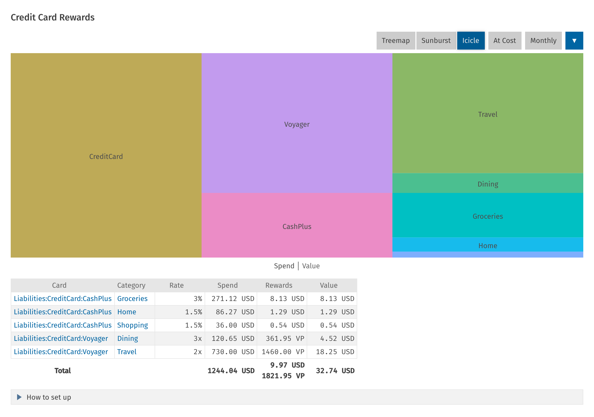

# Credit Card Rewards

```beancount
2020-01-01 custom "fava-extension" "beancount_sg.ext.rewards"
```

Totals each credit card's spending by the card issuer's category, with the rewards it earned and
their cash value.



## Setting up a card

Configure a card's rewards with metadata on its `open` directive. A cashback card needs only its
rates:

```beancount
2020-01-01 open Liabilities:CreditCard:CashPlus USD
  rewards: "cashback"
  rewards-rate: 1.5            ; the default rate, for categories without their own
  rewards-rate-groceries: 3    ; a category's rate
```

A points card can also name its points and give them a cash value:

```beancount
2020-01-01 open Liabilities:CreditCard:Voyager USD
  rewards: "points"
  rewards-rate-dining: 3
  rewards-rate-travel: 2
  rewards-unit: "VP"           ; optional, defaults to POINTS
  rewards-point-value: 0.0125  ; optional: a point's value in cash
```

- **Rates:** for `cashback`, 3 means 3% back in the currency spent; for `points`, 3 points per unit
  spent. `rewards-rate` defaults to 1.
- **Points' unit:** naming each program's points keeps points that aren't interchangeable, such as
  two banks' programs, from being added together in the totals.
- **Category keys** are the category slugified: `Food and Drink` uses
  `rewards-rate-food-and-drink`.
- Configuration errors are listed at the top of the report.

## Categories

Rates depend on the **card issuer's category** for a purchase, such as "Dining", which isn't
necessarily the expense account you book it to. So the category comes from metadata, as an importer
might record the bank's category: a posting's `category` metadata, or else its transaction's.

```beancount
2024-02-14 * "Trattoria Roma" "Dinner"
  category: "Dining"
  Liabilities:CreditCard:Voyager  -96.40 USD
  Expenses:Food:Restaurants
```

To read another metadata key, set it on the card: `rewards-category-key: "bank_category"`.
Spending without a category is `uncategorized`, and earns the default rate.

## What counts as spending

The `Expenses` postings of transactions that post to the card, or one of its subaccounts, within
the current Fava filter. Refunds count negatively. A transaction charging two configured cards is
skipped, since its spending can't be attributed to one of them.

Only `Expenses` postings count, so a payment from an `Assets` account is never spending. But a card
payment booked to an expense account looks just like a refund: the card is credited and an expense
account debited. List such accounts once, in the extension's config; each covers its subaccounts:

```beancount
2020-01-01 custom "fava-extension" "beancount_sg.ext.rewards" "{
  'exclude_accounts': ['Expenses:LoanPayments:CreditCardPayment'],
}"
```

None of this depends on categories: uncategorized spending, e.g. on a flat-rate card or before a
category is synced, still counts at the card's default rate.

## The report

The table has a row per card and category: the rate, spend, rewards and their cash value, with
totals per currency (so each program's points are totalled separately).

The chart shows spending (**Spend**) or the rewards' cash value (**Value**) by card, then category;
the icicle view shows this hierarchy most clearly. Value puts cashback and points cards on the
same scale; points without a `rewards-point-value` have no cash value, so they're left out of it.

Clicking a card opens its account page. Clicking a category, in the table or the chart, opens the
card's account page filtered to that category's transactions, keeping the current time range and
filter.
