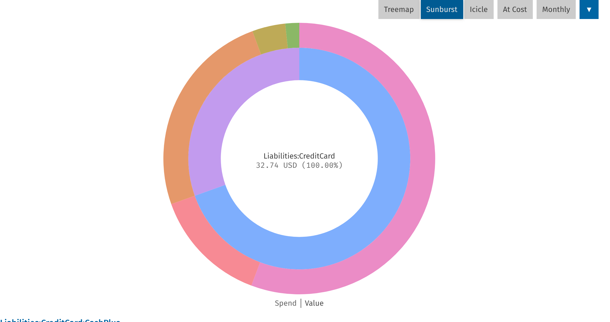

# Credit Card Rewards

```beancount
2020-01-01 custom "fava-extension" "beancount_sg.ext.rewards"
```

Totals each credit card's spending by category, with the rewards it earned and their cash value.


## Setting up a card

Configure a card's rewards with metadata on its `open` directive:

```beancount
2020-01-01 open Liabilities:CreditCard:Voyager USD
  rewards: "points"            ; or "cashback"
  rewards-rate: 1              ; the default rate, for categories without their own
  rewards-rate-dining: 3       ; a category's rate
  rewards-rate-travel: 2
  rewards-unit: "VP"           ; points only: what the points are called
  rewards-point-value: 0.0125  ; points only, optional: a point's value in cash
```

- **Rates:** for `cashback`, 3 means 3% back in the currency spent; for `points`, 3 points per unit
  spent. `rewards-rate` defaults to 1.
- **Category keys** are the category slugified: `Food and Drink` uses
  `rewards-rate-food-and-drink`.
- Configuration errors are listed at the top of the report.

## What counts as spending

The `Expenses` postings of transactions that post to the card, or one of its subaccounts, within
the current Fava filter. Refunds count negatively. A transaction charging two configured cards is
skipped, since its spending can't be attributed to one of them.

A posting's category is its `category` metadata, or else its transaction's:

```beancount
2024-02-14 * "Trattoria Roma" "Dinner"
  category: "Dining"
  Liabilities:CreditCard:Voyager  -96.40 USD
  Expenses:Food:Restaurants
```

Spending without a category is `uncategorized`, and earns the default rate.

## Charts

The chart shows spending (**Spend**) or the rewards' cash value (**Value**) by card, then category,
as a treemap, sunburst or icicle. Value puts cashback and points cards on the same scale; points
without a `rewards-point-value` have no cash value, so they're left out of it.



Clicking a card opens its account page. Clicking a category opens a page for a non-existent
`<card>:<category>` account, since Fava's charts link every node to an account.
