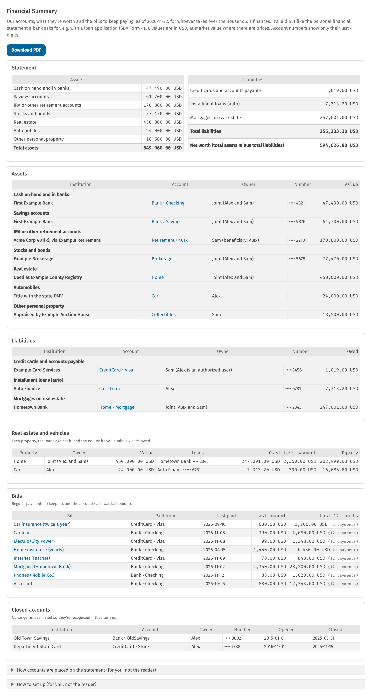

# Financial Summary

```beancount
2020-01-01 custom "fava-extension" "beancount_sg.ext.summary"
```

A summary of the household's finances for someone who doesn't use Beancount, e.g. a spouse taking
over in case of death: the real-world accounts and what they're worth, the equity in a home or car
with a loan on it, the bills to keep paying, and the accounts that were closed. **Download PDF**
gives the same as a PDF, to print or keep somewhere your family can find it.



The summary covers the whole ledger as of today, whatever Fava's filters. Values are at market
value in the first `operating_currency` where there are prices.

## Without Fava

The `bean-summary` command, installed with `beancount-sg` (Fava isn't needed), writes the same PDF
from a ledger file:

```bash
bean-summary ledger.beancount                       # writes financial-summary-<today>.pdf
bean-summary ledger.beancount -o summary.pdf -d 2026-12-31
```

`-o` names the PDF, and `-d` makes the summary as of another date. Errors in the ledger are
reported, but don't stop the summary.

## What it shows

It's laid out like the personal financial statement a bank asks for, e.g. with a loan application:
the US Small Business Administration's Form 413 (Personal Financial Statement), whose asset and
liability lines Fannie Mae's mortgage application (Form 1003) mostly shares.

- **Statement:** each asset and liability line's total, and net worth. Only lines with accounts are
  shown.
- **Assets** and **Liabilities:** each line's open accounts, sorted by **institution**, with each
  account's **owner** (or owners, if held jointly), the last 4 digits of its number, and its value
  (for a loan or card, what's owed).
- **Real estate and vehicles:** like the form's "real estate owned" schedule. Each property is
  listed with its value, owner and equity (value minus what's owed). Its loans are the liabilities
  opened under its matching account path, e.g. `Liabilities:Home:Mortgage` for `Assets:Home`, each
  with its lender, number and last payment.
- **Bills:** the accounts you mark, with when each was last paid and how much, the account that
  paid it, and what it came to over the last 12 months.
- **Closed accounts:** with their institutions, owners, the last 4 digits of their numbers, and
  when they were opened and closed, so they're recognized if a statement or letter turns up.

| Assets | Liabilities |
| --- | --- |
| Cash on hand and in banks (`cash`) | Credit cards and accounts payable (`credit-cards`) |
| Savings accounts (`savings`) | Notes payable to banks and others (`notes-payable`) |
| IRA or other retirement accounts (`retirement`) | Installment loans, auto (`auto-loans`) |
| Accounts and notes receivable (`receivables`) | Installment loans, other (`installment-loans`) |
| Life insurance, cash surrender value (`life-insurance`) | Loans against life insurance (`life-insurance-loans`) |
| Stocks and bonds (`stocks-bonds`) | Mortgages on real estate (`mortgages`) |
| Real estate (`real-estate`) | Unpaid taxes (`unpaid-taxes`) |
| Automobiles (`automobiles`) | Other liabilities (`other-liabilities`) |
| Other personal property (`personal-property`) | |
| Other assets (`other-assets`) | |

### Which line an account is on

Without a declaration, each account's line is inferred from what the ledger already says:

- **Assets**, in order:
  1. A retirement account by name (401k, 403b, 457, IRA, Roth, Pension, TSP or Retirement), even
     its cash.
  2. The `cash` [cash-flow role](cash-flow.md#the-statement): named with Cash, Checking, Savings or
     Bank, or declared `cash`. Savings if named Savings, Money Market or CD; otherwise cash.
  3. By name: receivables, life insurance, a vehicle (Car, Auto, Vehicle, Truck, Motorcycle, Boat,
     RV), or real estate (Home, House, Condo, Property, Land, Rental, Cabin).
  4. Real estate or a vehicle if a mortgage or vehicle loan is opened under its path. A margin loan
     under `Assets:Brokerage` doesn't make it property.
  5. Otherwise, stocks and bonds.
- **Liabilities**, in order:
  1. By name: a mortgage or HELOC, a card (or Amex, Visa, Mastercard, Discover), taxes, a life
     insurance loan, a vehicle loan, or a student, personal or installment loan.
  2. The property it's opened under: real estate's loans are mortgages, a vehicle's auto loans.
  3. A loan or note, by name: notes payable. Otherwise, other liabilities.

To place an account yourself, declare its line with `asset-type` or `liability-type`, on its `open`
directive or a parent's. An asset's type can also go on the `commodity` directive of what it holds,
e.g. a property tracked as its own commodity:

```beancount
2020-01-01 open Assets:Valuables USD
  asset-type: "personal-property"

2020-01-01 commodity HOUSE-MAIN-ST
  asset-type: "real-estate"

2020-01-01 open Liabilities:Family:Loan USD
  liability-type: "notes-payable"
```

The Fava page's "How accounts are placed on the statement" lists each account's line and why.

## Setting it up

Give each account its institution, owner and number on its `open` directive. These matter most:
they say who to call, and whose name the account is in. Write the owner as the reader should read
it, e.g. `"Alex"`, `"Joint (Alex and Sam)"`, or `"Sam (beneficiary: Alex)"`. An institution or owner
on a parent account applies to its subaccounts; a parent that holds nothing itself isn't listed.
Only the number's last 4 digits are shown, on the page and in the PDF:

```beancount
2020-01-01 open Assets:Bank
  institution: "First Example Bank"
  owner: "Joint (Alex and Sam)"

2020-01-01 open Assets:Bank:Checking USD
  account-number: "000123454321"
```

The Fava page (not the PDF) lists the open accounts still without an institution or owner, to fill
in.

Mark each bill with `bill`, on the account its payments go to: an expense account, e.g. a utility,
or a loan or card. `bill: TRUE` uses the account's name; a string names the bill for the reader:

```beancount
2020-01-01 open Expenses:Home:Electric USD
  bill: "Electric (City Power)"

2020-01-01 open Liabilities:Home:Mortgage USD
  bill: "Mortgage (Hometown Bank)"
```

A bill's payments are the transactions adding to its account: an expense, or a payment on a loan
or card (charges to a card aren't payments). A payment's amount is what left the accounts that paid
it, e.g. the whole mortgage payment from checking, interest included, and those accounts are what
it was paid from.

Download the PDF now and then, as balances and bills change, and keep it with your other important
papers.
