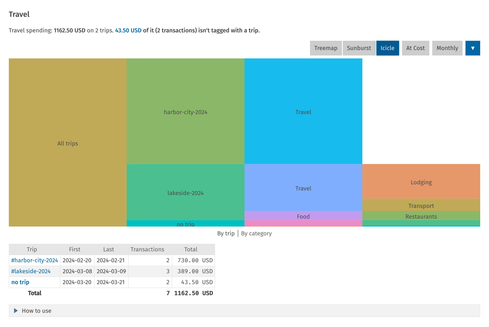

# Travel

```beancount
2020-01-01 custom "fava-extension" "beancount_sg.ext.travel"
```

Totals travel spending by trip and by expense category, and calls out travel spending that isn't
tagged with a trip.



## Trips

Travel spending is the expense postings of transactions tagged `#travel`, within the current Fava
filter. Refunds count negatively. A transaction's **trip** is its trip tag, such as `#miami-2025`:

```beancount
2025-02-01 * "Hotel" "Two nights" #travel #miami-2025
  Expenses:Travel:Lodging  400.00 USD
  Liabilities:CreditCard:Voyager
```

The [`tag_travel`](../../README.md#beancount_sgpluginstag_travel) plugin adds both tags from
`travel` events.

**Trip tags** are the tags that occur on `#travel` transactions and on no other transactions,
anywhere in the ledger (whatever Fava's filter). So a tag that's also used without `#travel`, such
as `#recurring` or `#reimbursable`, isn't a trip, and a travel transaction can carry it alongside
its trip. Two consequences:

- **One trip per transaction:** a travel transaction should have only one trip tag. One with
  several counts towards the first, alphabetically, and the report lists it in a warning so it can
  be fixed.
- **Trip tags stay on travel:** a trip tag used even once on a transaction without `#travel` stops
  being a trip, and its spending shows as "no trip". Tag that transaction `#travel` too, or remove
  its trip tag.

## The report

- **Untagged travel:** the line above the chart says how much travel spending isn't tagged with a
  trip, linked to those transactions. It's shown as "no trip" in the chart and the table.
- **Chart:** the spending **By trip**, then expense account, or **By category** (expense account),
  then trip. The icicle view shows the hierarchy most clearly.
- **Table:** each trip's first and last dates, number of transactions and total.

Every click opens a Fava page filtered by tag, within the current filter:

- A trip, in the table or the chart, opens the income statement filtered to `#travel #<trip>`.
- "no trip" opens it filtered to `#travel` without any of the trip tags.
- An expense account in the chart opens the account's page, filtered to its trip's travel
  transactions, or to all `#travel` in the **By category** chart's upper levels.
