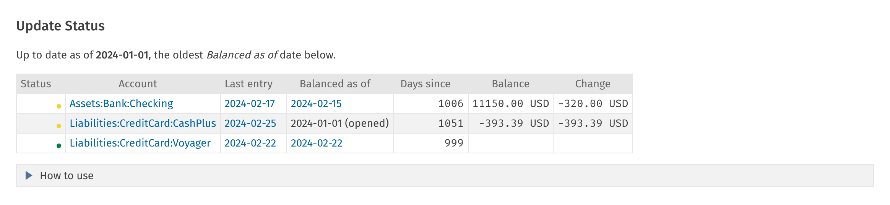

# Update Status

```beancount
2020-01-01 custom "fava-extension" "beancount_sg.ext.update_status"
```

Shows when each tracked account was last confirmed by a balance assertion, to see which accounts
need updating.



## Tracking an account

Add Fava's `fava-uptodate-indication` metadata to the account's `open` directive, the same metadata
that shows a status dot in Fava's sidebar.
[`uptodate_subaccounts`](../../README.md#beancount_sgpluginsuptodate_subaccounts) extends it to an
account's direct subaccounts.

```beancount
2020-01-01 open Assets:Bank:Checking USD
  fava-uptodate-indication: TRUE
```

Closed accounts aren't listed.

## The report

Each tracked account has:

- **Status:** Fava's dot. It's green if the account's last entry is a passing balance assertion,
  yellow if it's a transaction, and red if it's a failing balance assertion. Click a yellow or red
  dot to copy balance directives for today, as in Fava's sidebar.
- **Last entry:** the date of the account's last entry.
- **Balanced as of:** the date of its last passing balance assertion, or the date it was opened if
  it's never been balanced.
- **Days since:** days from that date to today.
- **Balance** and **Change**, only if the dot isn't green: the account's current balance, and how
  much it changed since its last passing balance assertion, per currency. That's what a new
  assertion needs to confirm. A currency that's never been asserted counts from zero.

**Up to date as of**, above the table, is the oldest *Balanced as of* date. A balance assertion
checks the balance at the start of its day, so it confirms the transactions before that date.

Click a date to open its entry, or a column header to sort. The report covers the whole ledger,
whatever Fava's filters, since it's about the accounts' current state.
