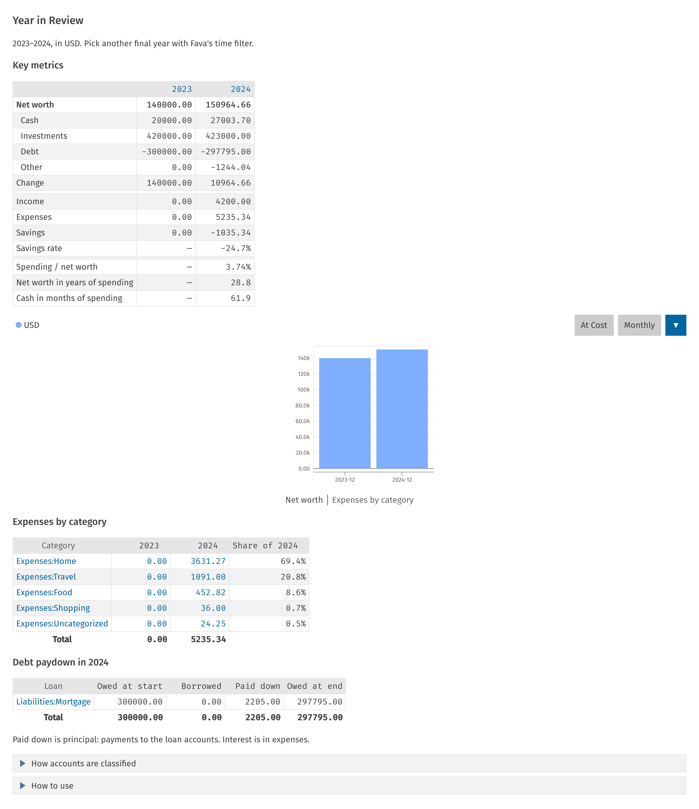

# Year in Review

```beancount
2020-01-01 custom "fava-extension" "beancount_sg.ext.year_end"
```

A year-end dashboard: net worth, income and spending, savings, spending against net worth, and
debt paydown, for up to five years.



## Which years

Up to five years, ending with the **last year of Fava's time filter**, or the current year if there
isn't one. Only that year is taken from Fava's filters: the figures always cover whole years of the
whole ledger, since filtering accounts or tags would make net worth meaningless. The current year
is year-to-date.

Values are in the ledger's first `operating_currency`. Holdings are at market value at each year's
end, or at cost if they have no price yet. Income and expenses are at their value on each
transaction's date. Amounts that can't be converted, for lack of prices, are left out and their
currencies listed.

## Key metrics

| Metric | |
| --- | --- |
| **Net worth** | Assets plus liabilities at the year's end, split into **cash**, **investments**, **debt** (loans) and **other** (e.g. credit card balances); see [account roles](#account-roles). |
| **Change** | Net worth's change over the year. |
| **Income, expenses, savings** | Savings is income minus expenses. |
| **Savings rate** | Savings as a percentage of income. |
| **Spending / net worth** | A year's expenses as a percentage of net worth at its start. Like a withdrawal rate in retirement: how much of your net worth a year's spending would use. |
| **Net worth in years of spending** | The inverse, at the year's end: 25 years is a 4% rate. |
| **Cash in months of spending** | Cash at the year's end, as an emergency fund. |

For the current year, the spending-based ratios use its spending so far, annualized. Ratios to a
net worth that isn't positive aren't shown.

The charts show net worth and expenses by category per year. Click a year's bar to make it the
final year.

## Expenses by category

Expenses per year by top-level category (e.g. `Expenses:Food`, not its subaccounts), with each
category's share of the final year. Click an amount for the account's page for that year.

## Debt paydown

For the final year, each loan's balance at the start, new borrowing, principal paid down, and
balance at the end. Interest is in expenses. Credit cards aren't loans here; see below.

## Account roles

Accounts are grouped by their **cash-flow role**, using the same metadata as
[Beancount.io's cash-flow report](https://beancount.io/blog/2026/08/28/declare-cash-flow-roles-in-your-ledger),
on the account's `open` directive:

```beancount
2020-01-01 open Assets:Bank:CD
  cash-flow-role: "investing"
```

The roles are `cash`, `investing`, `financing` and `operating`. A declared role also applies to the
account's subaccounts. Without one, the role comes from the account's name and type:

| Account | Default role | Shown as |
| --- | --- | --- |
| Assets named with Cash, Checking, Savings or Bank | `cash` | Cash |
| Other assets | `investing` | Investments |
| Liabilities named with Card | `operating` | Other (credit cards are everyday spending, not debt) |
| Other liabilities | `financing` | Debt |

The default for cards differs from Beancount.io's, which makes every liability `financing`. Declare
`cash-flow-role: "financing"` on a card to count it as debt, or `"operating"` on a loan to leave it
out. An unknown role is reported, and the default used. The page's "How accounts are classified"
section lists each account's role and where it came from.
